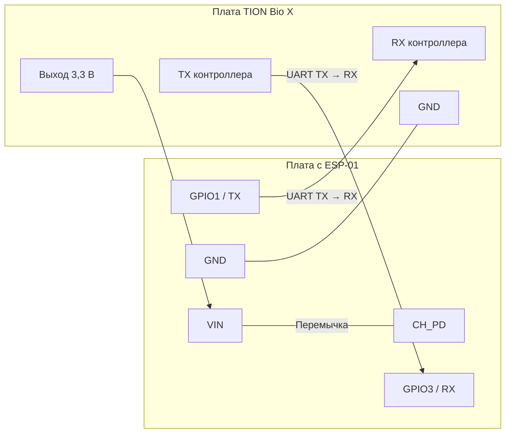

# Подключение ESP-01 к плате TION Bio X

## Схема соединений

ESP-01 питается непосредственно от выхода **3,3 В** платы TION Bio X. Отдельный стабилизатор питания не используется. На плате ESP-01 контакты **VIN и CH_PD соединяются перемычкой**; на эту общую точку подаётся 3,3 В.

Линии UART соединяются перекрёстно: TX одного устройства подключается к RX другого.

| Плата с ESP-01 | Плата TION Bio X |
|---|---|
| VIN и CH_PD (соединить между собой перемычкой) | Выход 3,3 В |
| GPIO1 / TX | RX контроллера |
| GPIO3 / RX | TX контроллера |
| GND | GND |

Параметры UART: **9600 бод, 8 бит, без чётности, 1 стоп-бит (8N1)**.

## Питание и электрические уровни

- Подавайте на объединённые контакты **VIN и CH_PD только 3,3 В** с выхода платы TION Bio X. В этой схеме отдельный источник питания не нужен.
- Это подключение допустимо только для платы ESP-01, у которой контакт VIN рассчитан именно на **3,3 В**. Не используйте эту схему для адаптеров, где VIN рассчитан на 5 В.
- Перед подключением мультиметром подтвердите, что выбранный вывод платы TION действительно выдаёт 3,3 В, а его стабилизатор способен обеспечить пиковый ток ESP-01. При просадках питания возможны перезагрузки и нестабильная работа.
- Обязательно объедините GND ESP-01 и платы TION Bio X.
- Вход RX ESP8266 (GPIO3) не является 5-вольтовым. Уровень сигнала с TX платы TION должен быть не выше допустимого для ESP8266 (ориентируйтесь на 3,3 В); при более высоком уровне используйте согласование уровней.
- Перед соединением TX ESP-01 с RX платы TION проверьте, что вход RX платы совместим с логическим уровнем 3,3 В.
- Не соединяйте TX с TX: передающая линия одного устройства подключается к RX другого.

## Режим загрузчика ESP-01

Эти сигналы нужны для первоначальной прошивки ESP-01 и не относятся к UART-соединению с TION:

- GPIO0 — GND во время старта в режиме загрузчика;
- GPIO2 — HIGH;
- CH_PD — HIGH (в этой схеме он соединён с VIN и получает 3,3 В);
- питание — стабильные 3,3 В.

После прошивки отключите GPIO0 от GND и перезапустите модуль.

> Распиновка разъёма и уровни UART на разных ревизиях плат могут отличаться. До подключения проверьте маркировку контактов и измерьте напряжения. Не подключайте линии UART вслепую.
