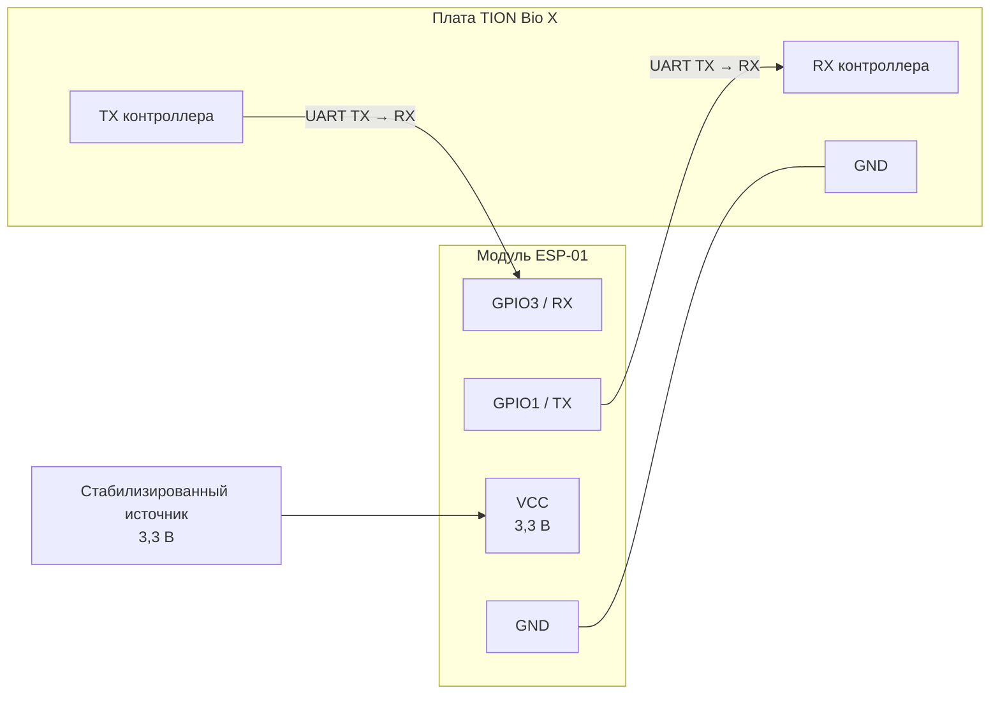

# Подключение ESP-01 к плате TION Bio X

## Схема соединений

Ниже показано подключение ESP-01 к UART платы TION Bio X. Линии TX и RX соединяются перекрёстно.

| ESP-01 | Плата TION Bio X |
|---|---|
| GPIO1 / TX | RX контроллера |
| GPIO3 / RX | TX контроллера |
| GND | GND |

Параметры UART: **9600 бод, 8 бит, без чётности, 1 стоп-бит (8N1)**.

## Питание и электрические уровни

- Питайте ESP-01 от отдельного стабилизированного источника **3,3 В** с достаточным запасом по току. Не подключайте питание к случайному выводу платы TION, пока не подтверждены его напряжение и допустимый ток.
- Обязательно объедините GND источника питания, ESP-01 и платы TION Bio X.
- Вход RX ESP8266 (GPIO3) не является 5-вольтовым. Уровень сигнала с TX платы TION должен быть не выше допустимого для ESP8266 (ориентируйтесь на 3,3 В); при более высоком уровне используйте согласование уровней.
- Перед соединением TX ESP-01 с RX платы TION проверьте, что вход RX платы совместим с логическим уровнем 3,3 В.
- Не соединяйте TX с TX: передающая линия одного устройства подключается к RX другого.

## Режим загрузчика ESP-01

Эти сигналы нужны для первоначальной прошивки ESP-01 и не относятся к UART-соединению с TION:

- GPIO0 — GND во время старта в режиме загрузчика;
- GPIO2 — HIGH;
- EN/CH_PD — HIGH;
- питание — стабильные 3,3 В.

После прошивки отключите GPIO0 от GND и перезапустите модуль.

> Распиновка разъёма и уровни UART на разных ревизиях плат могут отличаться. До подключения проверьте маркировку контактов и измерьте напряжения. Не подключайте линии UART вслепую.
